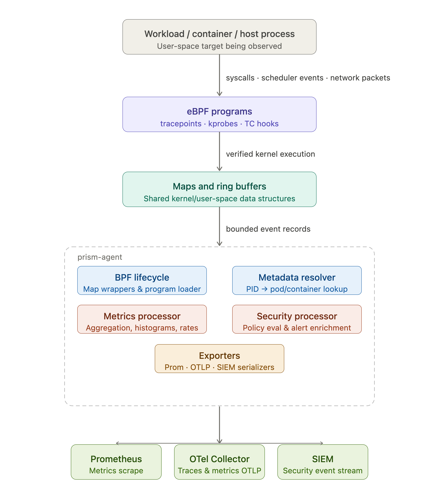

# Prism: eBPF Unified Observability Platform
## Technical Specification v0.1 Development Baseline

**Document status:** Frozen v0.1 development baseline  
**Product name:** Prism  
**Binary:** `prism-agent`  
**Primary language:** Rust  
**Kernel programs:** Rust/eBPF with `aya-ebpf`  
**User-space runtime:** Rust with `aya` and `tokio`  
**Initial target:** Linux kernel 5.10+, cgroup v2, x86_64  
**Deployment targets:** Kubernetes, Docker, Uncloud/systemd, bare metal Linux  

---

## 1. Product Goal

Prism is a host-level observability and security agent. It uses eBPF to collect infrastructure metrics, selected application telemetry, trace correlation signals, and security audit events without application sidecars or required source-code changes.

The implementation must be safety-first. Prism runs with kernel-facing privileges, so correctness, verifier compatibility, bounded memory use, and predictable cleanup are release blockers rather than polish work.

### 1.1 MVP Scope

The first production milestone is a node agent that:

- Loads and unloads eBPF programs reliably.
- Exposes per-cgroup infrastructure metrics through Prometheus.
- Resolves cgroup IDs to Docker, Kubernetes, or systemd metadata.
- Emits `execve` security audit events through OTLP logs.
- Survives repeated restart and crash-recovery cycles without accumulating stale pinned maps owned by Prism.

### 1.2 Deferred Scope

These features are part of the product vision but must not block the MVP foundation:

- In-kernel application protocol parsing beyond minimal plaintext HTTP detection.
- Full encrypted request tracing for every TLS library and application protocol. v1.0 supports connection-level telemetry for all encrypted traffic and opt-in TLS uprobes for approved libraries.
- Postgres and Redis semantic parsing.
- XDP fast-path packet processing.
- Multi-architecture packaging beyond x86_64.

### 1.3 Explicit Limitations

Zero-instrumentation tracing has hard limits:

- Plain eBPF packet parsing cannot inspect encrypted TLS payloads.
- W3C Trace Context extraction from network packets only works when headers are visible.
- TLS-aware tracing requires separate uprobes, language/runtime integrations, or application-layer collector support.
- `SIGKILL`, kernel panic, and host power loss cannot trigger graceful user-space cleanup. Prism must reconcile stale Prism-owned pins on the next startup.

---

## 2. Architecture

Prism uses a two-tier architecture.

### 2.1 Kernel Tier

The kernel tier is the data plane. eBPF programs attach to tracepoints, kprobes, and TC hooks. They must:

- Use fixed-size, verifier-friendly data structures.
- Avoid dynamic allocation.
- Bound all loops.
- Submit events through ring buffers or update aggregate maps.
- Never parse beyond verified packet or memory bounds.

### 2.2 User Tier

The user tier is the control plane. `prism-agent` loads programs, owns lifecycle cleanup, resolves metadata, aggregates events, and exports telemetry.



### 2.3 Trust Boundaries

- Kernel event records are untrusted until decoded and validated in user-space.
- Runtime metadata from Docker, CRI, Kubernetes, and Uncloud is untrusted input.
- Export endpoints must not expose secrets, bearer tokens, raw environment variables, or sensitive command-line arguments by default.

---

## 3. Workspace Layout

The repository must become a Cargo workspace before product implementation begins.

The Cargo workspace may contain multiple internal crates, but Prism is distributed as a single executable product: `prism-agent`. End users must not install, run, or manage individual workspace crates. The internal crate split exists to separate shared POD data contracts, eBPF programs, and the user-space daemon while still producing one agent binary for distribution.

```text
prism/
├── Cargo.toml
├── Makefile
├── .cargo/
│   └── config.toml
├── docs/
│   ├── prism_ebpf_arch.png
│   └── spec.md
├── prism-core/
│   ├── Cargo.toml
│   └── src/
│       ├── lib.rs
│       ├── events/
│       │   ├── mod.rs
│       │   ├── metrics.rs
│       │   ├── security.rs
│       │   └── trace.rs
│       └── ids/
│           ├── mod.rs
│           └── cgroup.rs
├── prism-ebpf/
│   ├── Cargo.toml
│   └── src/
│       ├── lib.rs
│       ├── maps/
│       │   └── mod.rs
│       └── programs/
│           ├── mod.rs
│           ├── exec.rs
│           ├── metrics.rs
│           └── net.rs
├── prism-agent/
│   ├── Cargo.toml
│   ├── build.rs
│   └── src/
│       ├── main.rs
│       ├── lib.rs
│       ├── bpf/
│       │   ├── mod.rs
│       │   ├── loader.rs
│       │   └── cleanup.rs
│       ├── config/
│       │   ├── mod.rs
│       │   └── settings.rs
│       ├── metadata/
│       │   ├── mod.rs
│       │   ├── docker.rs
│       │   ├── cri.rs
│       │   └── systemd.rs
│       ├── processors/
│       │   ├── mod.rs
│       │   ├── metrics.rs
│       │   └── security.rs
│       └── exporters/
│           ├── mod.rs
│           ├── otlp.rs
│           └── prometheus.rs
├── deploy/
│   ├── docker-compose.yaml
│   ├── helm/
│   └── systemd/
└── scripts/
    └── setup-dev.sh
```

Every `mod.rs` file must contain only module declarations and `pub use` re-exports.

---

## 4. Shared Data Contracts

`prism-core` contains shared event types used by eBPF and user-space code. It must support `no_std`.

### 4.1 Rules

- Shared types must use `#[repr(C)]` or `#[repr(transparent)]`.
- Shared event types must not contain `String`, `Vec`, `Box`, `HashMap`, references, or Rust enums with unspecified layout.
- Use fixed-size arrays for strings and byte buffers.
- Prevent padding leaks with explicit reserved fields or by deriving `bytemuck::Pod` and letting compilation fail.
- Use newtypes for semantically distinct IDs in user-space APIs.

### 4.2 Example Event Type

```rust
#![no_std]

use bytemuck::{Pod, Zeroable};

#[repr(C)]
#[derive(Debug, Clone, Copy, PartialEq, Eq, Zeroable, Pod)]
pub struct SpanEvent {
    pub trace_id: [u8; 16],
    pub span_id: [u8; 8],
    pub parent_span_id: [u8; 8],
    pub cgroup_id: u64,
    pub start_ns: u64,
    pub duration_ns: u64,
    pub http_status: u16,
    pub protocol: u8,
    pub reserved: [u8; 5],
}
```

The explicit `reserved` field is required so the type has no implicit padding.

---

## 5. eBPF Lifecycle

### 5.1 Startup

On startup, `prism-agent` must:

1. Read configuration.
2. Detect kernel features and BTF availability.
3. Reconcile stale Prism-owned pinned maps and links from previous crashes.
4. Load eBPF bytecode.
5. Create or open required maps.
6. Attach programs.
7. Start processors and exporters.

### 5.2 Shutdown

On `SIGTERM` or `SIGINT`, `prism-agent` must:

1. Stop accepting new export work.
2. Signal processors with `CancellationToken`.
3. Drain bounded channels for a configured timeout.
4. Detach links.
5. Unpin Prism-owned maps when configured for ephemeral operation.
6. Flush final metrics and logs.

### 5.3 Crash Recovery

`SIGKILL` cannot run destructors or async shutdown logic. To avoid persistent resource growth:

- All pinned map paths must live under a Prism-owned prefix, such as `/sys/fs/bpf/prism`.
- Pinned resources must include an agent instance ID and boot ID where possible.
- Startup reconciliation must remove stale Prism-owned resources that are not associated with a live agent.
- Integration tests must verify stable resource counts across kill-and-restart loops.

---

## 6. Core Components

### 6.1 BPF Loader

The loader owns all unsafe interaction with eBPF bytecode, maps, and links.

Requirements:

- Encapsulate raw `aya` map and program handles behind safe wrappers.
- Keep `unsafe` blocks minimal and document each block with `// SAFETY:`.
- Return structured errors with `thiserror` in library modules.
- Add application context with `anyhow::Context` in binary entrypoints.
- Never use `.unwrap()` in production code.
- Use `.expect()` only for invariant violations with a descriptive message.

### 6.2 Metadata Resolver

The resolver maps kernel cgroup IDs to runtime metadata.

```rust
#[async_trait::async_trait]
pub trait RuntimeProvider: Send + Sync {
    async fn resolve(&self, cgroup_id: CgroupId) -> Result<Option<ContainerMeta>, MetadataError>;
    async fn watch_events(&self) -> Result<RuntimeEventStream, MetadataError>;
}
```

Providers:

- `DockerProvider`: reads Docker API events through `docker.sock`.
- `CriProvider`: reads containerd or CRI-O metadata through CRI and is the primary Kubernetes node-local container source.
- `KubernetesProvider`: optional read-only Kubernetes API enrichment for pod labels, namespaces, owners, and workload identity.
- `SystemdProvider`: parses cgroup v2 slice paths for bare metal and Uncloud.

Caching rules:

- Use `tokio::sync::RwLock` only for short critical sections.
- Never hold locks across external I/O.
- Bound cache size and use TTL or event-driven invalidation.
- Expose cache hit, miss, stale, and eviction metrics.

### 6.3 Metrics Pipeline

Initial metrics:

- Per-cgroup CPU scheduling counters.
- Per-cgroup network byte and packet counters.
- Ring buffer drop counters.
- Agent self-metrics.

Prometheus endpoint:

- Default listen address: `127.0.0.1:9090`.
- Endpoint: `/metrics`.
- Labels must be bounded and sanitized.
- High-cardinality labels, such as full paths and command lines, are disabled by default.

### 6.4 Security Pipeline

Initial security event:

- `ProcessExec`: PID, PPID, UID, GID, cgroup ID, command name, executable path when safely available, and timestamp.

Rules:

- Do not collect full environment variables by default.
- Do not log secrets or raw command-line arguments unless explicitly configured.
- Apply bounded field lengths in kernel and user-space.
- Export through OTLP logs.

### 6.5 Tracing Pipeline

Prism must observe all network traffic at connection, byte, packet, and process/cgroup metadata level whether traffic is encrypted or plaintext.

Application-layer tracing has different visibility rules:

- Plaintext traffic can be parsed from packets when safe and bounded.
- Encrypted traffic must not be decrypted or payload-captured by default.
- Encrypted request-level tracing requires opt-in user-space TLS uprobes or runtime integrations for approved libraries.
- If TLS library support is unavailable, encrypted flows still produce connection-level telemetry, not HTTP headers, paths, SQL text, or request bodies.

---

## 7. Configuration

Configuration must support file-based and environment-variable input.

Required settings:

- `agent.node_name`
- `agent.instance_id`
- `bpf.pin_path`
- `bpf.ephemeral`
- `metadata.providers`
- `prometheus.listen_addr`
- `otlp.endpoint`
- `security.capture_process_exec`
- `security.capture_command_line`
- `logging.level`

Sensitive settings must come from environment variables or secret files and must never be logged.

---

## 8. Platform Usage And Deployment

Prism must support four first-class runtime environments: Docker, Kubernetes, Uncloud/systemd, and bare metal Linux. No networking platform or CNI is a product dependency. Prism owns its eBPF lifecycle directly through `aya`.

### 8.1 Shared Runtime Requirements

All environments require:

- Linux kernel 5.10 or newer.
- cgroup v2. cgroup v1 is not part of the MVP.
- BTF support at `/sys/kernel/btf/vmlinux`.
- Mounted bpffs, normally `/sys/fs/bpf`.
- Permission to load eBPF programs and create maps.
- Read access to `/sys/fs/cgroup`.
- Outbound access to the configured OTLP endpoint when OTLP export is enabled.

When map pinning is enabled, the BPF pin path is `/sys/fs/bpf/prism`. Every deployment must make that path writable by `prism-agent` and must allow startup reconciliation to remove stale Prism-owned pins.

### 8.2 Docker

Docker support is for local development, edge hosts, and small single-node deployments.

Distribution artifact:

- Container image: `ghcr.io/<org>/prism-agent:<version>`.
- Optional Compose file: `deploy/docker-compose.yaml`.

Required mounts:

- `/sys/fs/bpf:/sys/fs/bpf:rw`
- `/sys/fs/cgroup:/sys/fs/cgroup:ro`
- `/var/run/docker.sock:/var/run/docker.sock:ro` only when the Docker metadata provider is enabled.

Required container settings:

- `pid: host`
- `network_mode: host` when host-level network metrics or local Prometheus scraping are required.
- Capability set tested per kernel. Start with `BPF` and `PERFMON`; add `NET_ADMIN` only when TC hooks are enabled.

Expected usage:

```bash
docker compose -f deploy/docker-compose.yaml up -d
curl http://127.0.0.1:9090/metrics
docker compose -f deploy/docker-compose.yaml logs prism-agent
docker compose -f deploy/docker-compose.yaml pull prism-agent
docker compose -f deploy/docker-compose.yaml up -d prism-agent
docker compose -f deploy/docker-compose.yaml down
```

### 8.3 Kubernetes

Kubernetes support is for production clusters. Prism runs as a DaemonSet with one agent per node.

Distribution artifact:

- Helm chart: `deploy/helm/prism-agent`.
- Container image: `ghcr.io/<org>/prism-agent:<version>`.

Required host mounts:

- `/sys/fs/bpf`
- `/sys/fs/cgroup`
- Runtime socket for the enabled CRI provider, such as containerd or CRI-O.

Security requirements:

- Avoid `privileged: true` by default.
- Drop all capabilities first, then add the minimum verified set.
- Start with `BPF` and `PERFMON`.
- Add `NET_ADMIN` only when TC hooks are enabled.
- Add `SYS_RESOURCE` only when required for memlock or resource-limit handling on the target host.
- Avoid `SYS_ADMIN`; allow it only as a documented compatibility fallback for older or restricted environments where narrower capabilities cannot load eBPF.
- Use a read-only root filesystem where possible.
- Do not mount Docker or CRI sockets unless the corresponding provider is enabled.

Expected usage:

```bash
helm upgrade --install prism-agent deploy/helm/prism-agent \
  --namespace prism-system \
  --create-namespace \
  --set image.tag=<version>
kubectl -n prism-system rollout status daemonset/prism-agent
kubectl -n prism-system port-forward daemonset/prism-agent 9090:9090
curl http://127.0.0.1:9090/metrics
kubectl -n prism-system logs daemonset/prism-agent
helm upgrade prism-agent deploy/helm/prism-agent \
  --namespace prism-system \
  --set image.tag=<new-version>
helm uninstall prism-agent --namespace prism-system
```

### 8.4 Uncloud

Uncloud support uses the same binary and systemd packaging as bare metal, with Uncloud-specific metadata resolution through cgroup v2 systemd slices or the Uncloud API when configured.

Distribution artifacts:

- Debian package: `prism-agent_<version>_amd64.deb`.
- RPM package: `prism-agent-<version>.x86_64.rpm`.
- Optional static tarball: `prism-agent-<version>-x86_64-unknown-linux-musl.tar.gz`.

Required host access:

- Writable BPF pin path.
- Read access to `/sys/fs/cgroup`.
- Read access to systemd unit and slice metadata.
- Uncloud API credentials only if API metadata resolution is enabled.

Expected usage:

```bash
sudo apt install ./prism-agent_<version>_amd64.deb
sudo editor /etc/prism/config.yaml
sudo systemctl enable --now prism-agent
systemctl status prism-agent
curl http://127.0.0.1:9090/metrics
journalctl -u prism-agent -f
sudo apt install ./prism-agent_<new-version>_amd64.deb
sudo systemctl stop prism-agent
sudo apt remove prism-agent
```

### 8.5 Bare Metal Linux

Bare metal support is for Linux hosts outside Docker and Kubernetes. It uses the systemd service and the `SystemdProvider`.

Distribution artifacts:

- Debian package.
- RPM package.
- Static tarball for manual installation.

Required host setup:

- bpffs mounted at `/sys/fs/bpf`.
- `prism-agent` service user or root execution model documented per distro.
- Config file at `/etc/prism/config.yaml`.
- systemd unit at `deploy/systemd/prism-agent.service`.

Expected usage:

```bash
sudo install -m 0755 prism-agent /usr/local/bin/prism-agent
sudo install -m 0644 deploy/systemd/prism-agent.service /etc/systemd/system/prism-agent.service
sudo install -d -m 0755 /etc/prism
sudo install -m 0644 config/example.yaml /etc/prism/config.yaml
sudo systemctl daemon-reload
sudo systemctl enable --now prism-agent
curl http://127.0.0.1:9090/metrics
journalctl -u prism-agent -f
sudo systemctl stop prism-agent
sudo install -m 0755 prism-agent-new /usr/local/bin/prism-agent
sudo systemctl start prism-agent
sudo systemctl disable --now prism-agent
sudo rm -f /etc/systemd/system/prism-agent.service /usr/local/bin/prism-agent
```

---

## 9. Development Environment

### 9.1 Supported Development Hosts

Preferred development environment:

- Linux VM or native Linux host.
- Ubuntu 22.04 or newer for the default setup path.
- Kernel 5.15 or newer during development, even though runtime support begins at 5.10.

macOS may be used for editing and user-space-only checks, but eBPF load, verifier, and integration tests must run inside a Linux VM or remote Linux host. Developers must not treat a successful macOS build as a complete validation.

### 9.2 Required Tools

- Rust stable toolchain for user-space crates.
- `rust-src`, `clippy`, and `rustfmt`.
- `x86_64-unknown-linux-musl` Rust target.
- GNU Make or BSD Make with the repository targets verified on Linux.
- `bpf-linker`.
- LLVM and Clang.
- `bpftool`.
- Linux headers for the running kernel.
- Musl toolchain for static user-space builds.
- Docker for image and Compose validation.
- `kind`, `kubectl`, and Helm for Kubernetes validation.
- `cargo-audit`, `cargo-deny`, and `cargo-fuzz` for quality gates.

### 9.3 Environment Verification

The repository must include `scripts/setup-dev.sh`. The script must verify:

- Rust toolchain and required components.
- Installed Rust targets.
- Make availability.
- `bpf-linker`.
- LLVM/Clang availability.
- `bpftool`.
- BTF availability at `/sys/kernel/btf/vmlinux`.
- bpffs mount at `/sys/fs/bpf`.
- Docker availability when Docker tests are requested.
- `kubectl`, Helm, and `kind` availability when Kubernetes tests are requested.

The script must fail fast for missing build prerequisites and must print remediation commands for supported Linux distributions.

### 9.4 Standard Developer Commands

The Makefile is the supported developer interface. Developers should not run raw Cargo command sequences for standard workflows because that bypasses shared flags, lint policy, environment checks, and target selection.

```bash
./scripts/setup-dev.sh
make dev
make lint
make test
make build
sudo ./target/x86_64-unknown-linux-musl/release/prism-agent --config ./config/dev.yaml
```

Required Make targets:

- `make dev`: run setup checks needed for local development, then build the workspace in debug mode.
- `make fmt`: check formatting for the full workspace.
- `make lint`: run clippy with `-D warnings` and `-W clippy::pedantic` for the full workspace.
- `make test`: run the full workspace test suite.
- `make build`: build the local release `prism-agent` binary for the developer host.
- `make ebpf`: build eBPF programs for `bpfel-unknown-none`.
- `make audit`: run dependency, license, and advisory checks.
- `make perf`: run the performance benchmark suite.
- `make ci`: run the complete pull-request quality gate locally.
- `make package`: build Linux distribution artifacts, including the `x86_64-unknown-linux-musl` binary.

### 9.5 Development Environment Acceptance Criteria

- A new developer can run `scripts/setup-dev.sh` and receive clear pass/fail output.
- The documented Make targets build the agent from a clean checkout.
- The agent can load and unload the minimal eBPF program on the supported Linux development host.
- Docker Compose validation can scrape `/metrics`.
- Kubernetes validation can deploy the Helm chart to `kind`.

---

## 10. Packaging, Distribution, And CI/CD

### 10.1 Artifacts

Every release must produce:

- Static Linux binary: `prism-agent`.
- Container image: `ghcr.io/<org>/prism-agent:<semver>`.
- Container image tag: `ghcr.io/<org>/prism-agent:latest` only for stable releases.
- Debian package.
- RPM package.
- Static tarball with binary, example config, license, and checksums.
- Helm chart package.
- SBOM in SPDX or CycloneDX format.
- SHA-256 checksums for downloadable artifacts.

### 10.2 Container Image

The production image must:

- Use a minimal runtime base, preferably distroless.
- Include only `prism-agent`, default config, license, and required CA certificates.
- Run with no shell or package manager.
- Not embed secrets.
- Expose the Prometheus listen port only when configured.

### 10.3 Package Layout

Debian and RPM packages must install:

- Binary: `/usr/bin/prism-agent`.
- Config: `/etc/prism/config.yaml`.
- Example config: `/usr/share/doc/prism-agent/config.example.yaml`.
- systemd unit: `/lib/systemd/system/prism-agent.service` or distro-equivalent path.
- License and notices.

Package scripts must:

- Create the `prism` user when a non-root model is supported.
- Ensure `/sys/fs/bpf` is mounted or provide a clear error.
- Run `systemctl daemon-reload` after install or upgrade.
- Never overwrite an existing `/etc/prism/config.yaml` without preserving the local file.

### 10.4 CI Pipeline

Pull request CI must run:

- `make fmt`.
- `make lint`.
- `make test`.
- Shared event layout tests.
- `make audit`.
- `make ebpf`.
- Minimal verifier smoke test on a supported Linux runner when available.

Main branch CI must additionally run:

- `make package`.
- Docker Compose smoke test.
- Helm template validation.
- `kind` deployment smoke test when runner privileges allow it.
- SBOM generation.
- Artifact checksum generation.

### 10.5 Manual GitHub Release Flow

Releases are manually triggered from GitHub Actions. Automatic publishing from every merge is prohibited.

Release trigger:

- GitHub Actions `workflow_dispatch`.
- Required input: semantic version, such as `v0.1.0`.
- Required input: release channel, one of `alpha`, `beta`, `stable`.
- Required input: publish confirmation.

Manual release workflow:

1. Validate the version tag does not already exist.
2. Run the full CI test matrix.
3. Build release artifacts.
4. Generate SBOM and checksums.
5. Scan the container image and packages.
6. Sign artifacts and container image with Sigstore Cosign.
7. Create a signed Git tag.
8. Create a GitHub Release in draft mode.
9. Upload artifacts, SBOM, checksums, and release notes.
10. Require maintainer review before publishing the GitHub Release.
11. Push the container image to GHCR only after release approval.
12. Publish the Helm chart package only after release approval.

Release rollback:

- Never delete published version tags.
- Mark broken GitHub Releases as deprecated in the release notes.
- Publish a patch release with fixes.
- Move the `latest` image tag only after a stable patch release passes validation.

### 10.6 Distribution Channels

Approved distribution channels:

- GitHub Releases for binaries, packages, checksums, SBOMs, and release notes.
- GitHub Container Registry for container images.
- Helm chart artifact attached to GitHub Releases.
- Optional package repository only after the manual GitHub release flow is stable.

The spec intentionally excludes any mandatory dependency on Kubernetes networking plugins, service meshes, or third-party observability agents.

---

## 11. Rust Engineering Standards

These standards apply to all Rust crates:

- Organize modules by feature.
- Keep `main.rs` minimal and place logic in `lib.rs`.
- Use the `mod` plus `pub use` re-export pattern.
- Keep every `mod.rs` file limited to declarations and re-exports.
- Prefer borrowing over cloning.
- Keep function parameters to five or fewer; use config structs for larger inputs.
- Return early to reduce nesting.
- Use iterators where they are clearer and at least as efficient.
- Use `thiserror` for library errors.
- Use `anyhow` for binary entrypoint orchestration.
- Use bounded channels for event pipelines.
- Avoid wildcard imports except `use super::*` in test modules and explicit preludes.
- Use Makefile targets for standard workflows. Raw Cargo commands may be used only for focused local debugging, not as a substitute for required gates.
- `make lint` must run clippy with `-D warnings` and `-W clippy::pedantic`.
- Clippy pedantic findings must be fixed directly. Do not add `#[allow(clippy::...)]`, relax lint flags, hide code behind feature gates, or create wrapper targets to bypass pedantic lint failures.

### 11.1 Dependencies

Dependencies must be documented in `Cargo.toml` with explicit version constraints. Initial expected dependency categories:

- eBPF: `aya`, `aya-ebpf`, `bpf-linker`.
- Shared POD types: `bytemuck`.
- Async runtime: `tokio`, `tokio-util`.
- Errors: `thiserror`, `anyhow`.
- Observability: `tracing`, `tracing-subscriber`, `opentelemetry`, `opentelemetry_sdk`, `opentelemetry-otlp`.
- Metadata clients: Docker and CRI clients selected during implementation.
- Testing: `mockall`, `proptest`, `criterion`, `cargo-fuzz`.

Initial approved OpenTelemetry crate versions:

- `opentelemetry = "0.32"`
- `opentelemetry_sdk = "0.32"`
- `opentelemetry-otlp = "0.32"`

All OpenTelemetry crates must be versioned as one compatible family in workspace dependencies.

---

## 12. Testing Strategy

### 12.1 Unit Tests

Required for:

- Shared event layout and size assertions.
- Metadata parsing.
- Config parsing and validation.
- Export formatting.
- Error mapping.

### 12.2 Integration Tests

Required for:

- Agent startup and graceful shutdown.
- eBPF load and attach on supported kernels.
- Stale pin reconciliation after forced termination.
- Docker metadata resolution.
- Prometheus scrape output.
- OTLP export to a local collector.

### 12.3 Verifier Tests

Verifier tests must run on actual kernels, not only against headers. CI should use a kernel matrix when practical:

- 5.10
- 5.15
- 6.1
- latest supported LTS kernel

### 12.4 Fuzzing

Fuzz any parser that reads packet payloads, command data, runtime metadata, or external config. PR fuzzing may run a short smoke target; release candidates must run longer jobs.

### 12.5 Benchmarks

Benchmarks must measure:

- Agent CPU overhead.
- Agent RSS.
- Ring buffer drops.
- Event processing latency.
- Metadata cache hit ratio.

Performance targets for MVP:

- User-space RSS below 256 MiB during the standard benchmark profile.
- CPU overhead below 3% per core during the standard benchmark profile.
- Zero ring buffer drops during the standard benchmark profile.

Drops outside the benchmark profile are not automatically release blockers, but they must be counted, exported, and documented.

---

## 13. Acceptance Criteria

### 13.1 MVP Functional Criteria

- `prism-agent` loads, attaches, detaches, and exits cleanly on `SIGTERM`.
- Startup reconciliation removes stale Prism-owned resources from previous crashed agents.
- Prometheus exposes per-cgroup infrastructure metrics.
- Docker metadata resolution labels metrics with container ID and container name.
- Kubernetes metadata resolution labels metrics with namespace, pod, and container name.
- Systemd metadata resolution labels host processes with slice information.
- `execve` audit events are exported through OTLP logs.
- No production path uses `.unwrap()`.
- All unsafe blocks include a specific `// SAFETY:` explanation.

### 13.2 Platform Criteria

- Docker Compose deployment starts the agent, resolves Docker metadata, and exposes `/metrics`.
- Kubernetes Helm deployment installs as a DaemonSet, rolls out successfully, resolves pod metadata, and exposes `/metrics`.
- Uncloud/systemd deployment installs from a package, starts with systemd, resolves systemd or Uncloud metadata, and stops cleanly.
- Bare metal deployment installs from a package or tarball, starts with systemd, and exposes host process metrics.
- All four platform guides include install, validate, view logs, upgrade, and uninstall steps.

### 13.3 Packaging And Release Criteria

- Manual GitHub release workflow builds all approved artifacts.
- GitHub Release contains checksums, SBOM, packages, tarball, Helm chart, and release notes.
- Container image is published to GHCR only through the manual release workflow.
- Stable releases sign binaries, packages, and container images.
- Debian and RPM package upgrades preserve `/etc/prism/config.yaml`.
- Helm chart renders successfully with default values and production values.

### 13.4 MVP Non-Functional Criteria

- `make fmt` passes.
- `make lint` passes with `-D warnings` and `-W clippy::pedantic`.
- `make test` passes.
- `make audit` has no critical or high unignored findings.
- eBPF verifier tests pass on the supported kernel matrix.
- Forced kill-and-restart loop does not increase Prism-owned pinned map or link count after startup reconciliation.

---

## 14. Delivery Plan

### Epic 1: Workspace And Lifecycle

- Create the Cargo workspace.
- Add the root Makefile with `dev`, `fmt`, `lint`, `test`, `build`, `ebpf`, `audit`, `ci`, and `package` targets.
- Add `prism-core`, `prism-ebpf`, and `prism-agent`.
- Add shared event layout tests.
- Load a minimal eBPF program.
- Implement graceful shutdown.
- Implement stale pin reconciliation.
- Add CI that runs the Makefile gates for formatting, pedantic linting, tests, eBPF build, and audit.

### Epic 2: Metadata

- Define `RuntimeProvider`.
- Implement bounded metadata cache.
- Implement Docker provider.
- Implement CRI provider.
- Implement Systemd/Uncloud provider.
- Expose resolver self-metrics.

### Epic 3: Metrics

- Implement CPU scheduling counters.
- Implement network counters through TC where enabled.
- Implement Prometheus exporter.
- Add load benchmark profile.

### Epic 4: Security

- Implement `execve` audit event capture.
- Add OTLP logs exporter.
- Add redaction and field-bound tests.

### Epic 5: Packaging And Hardening

- Add Docker image build and Compose manifest.
- Add Helm chart with default and production values.
- Add systemd unit, Debian package, RPM package, and static tarball.
- Add SBOM and checksum generation.
- Add image, binary, and package signing.
- Add manual GitHub release workflow.
- Add usage documentation for Docker, Kubernetes, Uncloud, and bare metal.

### Epic 6: Application Telemetry

- Add plaintext HTTP/1.1 parser prototype.
- Add connection-level telemetry for encrypted and plaintext traffic.
- Add opt-in TLS uprobe tracing for approved TLS libraries.
- Add fuzz targets.
- Use a hybrid tracing strategy: packet parsing for plaintext, uprobes/runtime integrations for encrypted request metadata, and connection spans when request metadata is unavailable.

---

## 15. Architecture Decisions

This section records the binding architecture decisions for MVP implementation.

### 15.1 Specification Baseline And Change Control

This document is the frozen v0.1 development baseline. It must be committed before implementation begins.

After the baseline commit:

- Do not silently rewrite product scope, safety rules, deployment requirements, or release criteria.
- Material changes must be added as new architecture decisions in this section.
- Small editorial fixes may be made directly if they do not change meaning.
- Implementation work must reference this baseline until a newer baseline is explicitly approved.

### 15.2 BPF Map Pinning

Default: ephemeral maps.

Pinned maps are disabled by default because default pinning increases cleanup risk after crashes and complicates upgrades. Pinning is allowed only for maps that must survive agent restart, be shared across agent processes, or support a documented operational workflow.

Rules:

- All pinned maps must live under `/sys/fs/bpf/prism`.
- Pinned resource names must include map purpose, schema version, boot ID when available, and agent instance ID.
- Startup reconciliation must remove stale Prism-owned pins before attaching new programs.
- Production deployments may enable pinning per map through config, not as a global hidden default.

### 15.3 Linux Capabilities

Default minimum for modern kernels:

- `CAP_BPF`
- `CAP_PERFMON`

Conditional capabilities:

- `CAP_NET_ADMIN` only for TC or network-interface attachment.
- `CAP_SYS_RESOURCE` only for memlock or resource-limit handling where required.
- `CAP_DAC_READ_SEARCH` only if file metadata collection requires host file traversal.
- `CAP_SYS_PTRACE` only for approved uprobe/runtime tracing features that demonstrably require it.

`CAP_SYS_ADMIN` is not part of the standard deployment profile. It may be documented as a compatibility fallback only when a target platform cannot support narrower Linux 5.8+ eBPF capabilities.

### 15.4 cgroup Version Support

Default: cgroup v2 only for MVP and v1.0.

cgroup v2 is the industry direction for modern Kubernetes, Docker, and systemd deployments. Supporting v1 would add parser paths, metric semantics, test matrix size, and support burden for older hosts. The product should detect cgroup v1 and fail with a clear error that explains the requirement.

cgroup v1 may be reconsidered after v1.0 only if there is a paying or strategically important environment that cannot move to cgroup v2.

### 15.5 Kubernetes Metadata Source

Default: hybrid CRI plus optional Kubernetes API enrichment.

CRI is the primary node-local source for mapping containers to cgroups because it works close to the runtime and avoids broad Kubernetes API dependence. The Kubernetes API should be used for enrichment that CRI does not reliably provide, such as namespace labels, workload ownership, and selected pod labels.

Safety rules:

- Kubernetes API access must be read-only.
- RBAC must grant only `get`, `list`, and `watch` for the exact resources needed.
- Default enrichment resources: pods, namespaces, and nodes.
- Labels and annotations are allowlisted. Prism must not ingest all labels or annotations by default.
- The agent must continue producing node-local telemetry if Kubernetes API enrichment is disabled or temporarily unavailable.

### 15.6 OTLP Crates

OTLP means OpenTelemetry Protocol, the export protocol Prism uses to send traces, metrics, and logs to an OpenTelemetry Collector.

Approved Rust crates for MVP:

- `opentelemetry = "0.32"`
- `opentelemetry_sdk = "0.32"`
- `opentelemetry-otlp = "0.32"`

Rules:

- Define these versions once in workspace dependencies.
- Keep the OpenTelemetry crate family on compatible minor versions.
- Prefer OTLP gRPC export for traces and logs.
- Prometheus remains the primary scrape path for MVP metrics.
- Dependency upgrades require `make test`, `make lint`, `make audit`, and an OTLP integration test against a local collector.

### 15.7 Encrypted Traffic

Prism must support encrypted and plaintext traffic in v1.0, but support is tiered by visibility.

Required in v1.0:

- Network and connection telemetry for all traffic.
- Process, cgroup, and runtime metadata for encrypted and plaintext flows.
- Packet parsing for plaintext protocols where safe.
- Opt-in TLS uprobe tracing for approved TLS libraries.

Not required by default:

- Decrypting payloads.
- Capturing request or response bodies.
- Capturing secrets, authorization headers, cookies, or raw TLS keys.

If encrypted request metadata cannot be observed safely, Prism emits connection-level spans and metrics rather than pretending to produce full application traces.

### 15.8 High-Cardinality Security Fields

Default: opt-in per event type with allowlists.

High-cardinality fields can create expensive telemetry bills, overload storage backends, and leak sensitive data. Fields such as full command lines, full file paths, environment variables, container labels, Kubernetes annotations, request paths, and SQL text must be disabled by default unless explicitly allowlisted.

Rules:

- Each security event type owns its own field policy.
- Global settings may cap maximum field length and total event size.
- Sensitive fields must support redaction before export.
- Default events include stable identifiers, bounded names, severity, timestamps, cgroup ID, runtime identity, and executable basename where safe.
- Full command line, full path, and raw arguments require explicit configuration.
